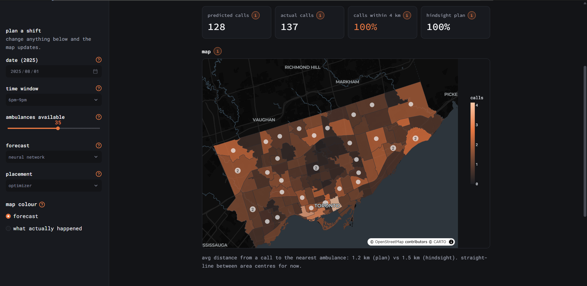

# TPS planner

A forecasting and planning tool for Toronto Paramedic Services. Machine learning models (gradient boosting and a PyTorch neural network) predict calls for each postal area in 3-hour windows, using 1.5 million calls from 2021–2025, and an integer optimization model places ambulances to reach as many predicted calls as possible.



## Why

Toronto's response times to life-threatening calls have grown from about 12 to almost 15 minutes (90th percentile, 2019–2025) while call volume rises every year. Toronto's Auditor General (2024) found the service hadn't analysed optimal staffing against daily, weekly and seasonal demand surges. **If we can predict roughly where calls will come from, where should free ambulances wait?**

## Results

Trained on 2021–2024, tested on 2025 (data the models never saw). Every forecast uses only data from at least a week earlier.

**Forecasting** (calls per postal area per 3-hour window, lower is better)

| Method | Error per area | Error for city total | Bias |
|---|---|---|---|
| Last week | 1.057 | 11.7 | −0.1 |
| Last 4 weeks | 0.894 | 9.4 | −0.3 |
| Historical average | **0.814** | 10.5 | −7.1 |
| Gradient boosting | 0.817 | **8.6** | **−1.4** |
| Neural network (PyTorch) | 0.818 | 8.8 | −2.4 |

- Both ML models cut city-wide error by about 9% versus the best baseline and remove the historical average's underprediction caused by year-over-year growth.
- Per area, all good methods sit near **0.805**, the error a perfect forecast would still have, because emergencies are random. Most of the remaining per-area error can't be predicted.

**Placement** (full-year replay of 2025, 10 ambulances, share of real calls reached within 4 km)

| Placement | Forecast | Calls reached | Avg km to nearest ambulance |
|---|---|---|---|
| Optimizer | Perfect hindsight | 93.9% | 2.64 |
| Optimizer | Gradient boosting | **87.8%** | 2.76 |
| Optimizer | Historical average | 87.8% | 2.79 |
| Simple rule | Gradient boosting | 75.8% | 3.30 |
| Simple rule | Historical average | 76.2% | 3.27 |

- **The optimization model reaches 12 percentage points more calls** than a greedy rule with the same 10 ambulances (75.8% → 87.8%), and cuts the average distance to the nearest ambulance from **3.30** to **2.76** km.
- **How you place matters more than how you forecast.** With the optimizer, gradient boosting and the historical average tie for placement: placement depends on *which areas* are busier, which the average already captures. The ML models' advantage is the *city total*, which matters more for how many ambulances to schedule.
- A perfect forecast would reach 93.9%, so better forecasts could add up to about 6 more points.
- Urgent calls (Echo and Delta) follow the same pattern.

## How it works

1. **Clean** 1.5M incidents (2021–2025): remove duplicates and non-Toronto calls, and mark system outages and daylight-saving gaps as missing instead of zero.
2. **Count** calls for each of Toronto's 96 postal areas in 3-hour windows (one-hour windows were 72% zeros).
3. **Forecast** with baselines, gradient boosting (scikit-learn, Poisson loss) and a PyTorch network with learned embeddings for area, time slot, weekday and month. Early stopping on 2024.
4. **Place ambulances** by solving a maximal covering location problem (integer program, scipy/HiGHS) with a small tie-breaking bonus for backup coverage.
5. **Replay** every 2025 window: plan with each forecast, score on what really happened.
6. **Explore** in a Streamlit app: pick a date, time and fleet size, and compare forecasts and placement methods on a map.

## Run it

```bash
python -m venv .venv
.venv\Scripts\activate            # mac/linux: source .venv/bin/activate
pip install -r requirements.txt
```

Download the [Paramedic Services Incident Data](https://open.toronto.ca/) (2021–2025) into `data/raw/`, then run the scripts in `notebooks/` in this order: 01, 02, 03, 04, 05, 08, 07. Then start the app:

```bash
streamlit run app.py
```

## Limitations

- Locations are postal-area centres, and distance is straight-line. Real road travel times are a planned upgrade.
- "Covered" means within 4 km, a rough stand-in for the 8-minute target. It ignores ambulances already busy at hospitals.
- The public dataset is a filtered subset of all calls (about 286k vs 319k official emergency requests in 2021).
- A research prototype, not a dispatch tool.

## Data

- City of Toronto Open Data: Paramedic Services Incident Data, Pre-hospital Emergency Care performance metrics
- Statistics Canada: 2021 Census Forward Sortation Area boundary file

## Built with

Python, pandas, scikit-learn, PyTorch, scipy, Streamlit, Plotly
